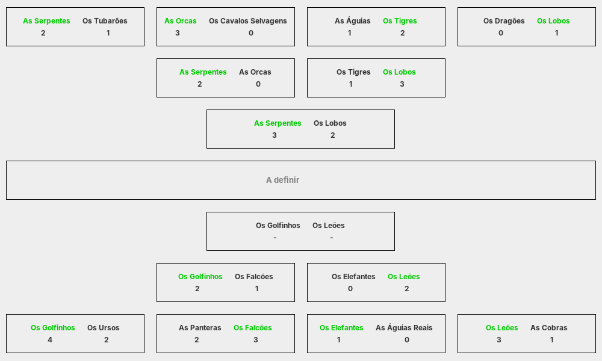
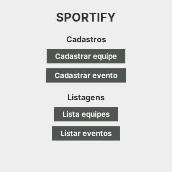
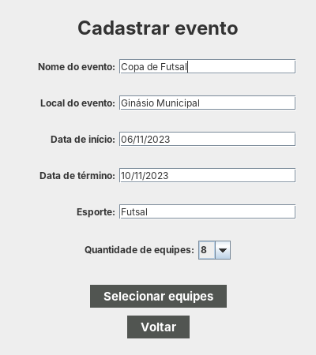
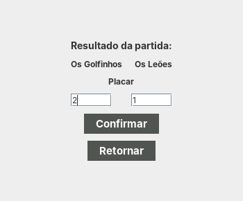

<div align="center">


# Sportify

**Aplicação desktop para organizar torneios eliminatórios, feita com Java Swing, Hibernate e PostgreSQL.**


</div>

[English](README.md) · **Português**

> [!NOTE]
> Projeto feito em equipe para a disciplina de **Projeto Temático II** da [Universidade de Caxias do Sul](https://www.ucs.br/) (UCS), em 2023.



---

## Sobre

O Sportify ajuda a organizar torneios esportivos no formato mata-mata. O usuário cadastra equipes e eventos, vincula as equipes a um evento e o sistema sorteia a chave. Conforme os resultados são registrados, os vencedores avançam de fase até a final.

## Funcionalidades

- **Equipes:** cadastro, listagem, edição e remoção.
- **Eventos:** nome, local, esporte, datas de início e fim e quantidade de equipes (2, 4, 8 ou 16).
- **Vínculo de equipes ao evento,** respeitando a quantidade de equipes prevista.
- **Sorteio da chave:** as equipes são embaralhadas e emparelhadas, e as primeiras partidas são criadas na fase certa (oitavas, quartas, semifinal ou final, conforme o tamanho do evento).
- **Resultados:** o placar é registrado partida a partida, empates são recusados e, quando um par de partidas se resolve, a partida da fase seguinte é criada automaticamente.
- **Visualização da chave** com todas as fases do evento.

<table>
<tr>
<td width="33%" align="center"><p><sub>Menu principal</sub></p></td>
<td width="33%" align="center"><p><sub>Cadastro de evento</sub></p></td>
<td width="33%" align="center"><p><sub>Registro de resultado</sub></p></td>
</tr>
</table>

## Arquitetura

A aplicação segue uma divisão **MVC** com camada de acesso a dados:

```
view (Swing)  →  controller  →  DAO  →  Hibernate  →  PostgreSQL
                     ↑
                   model (entidades JPA)
```

- **model:** entidades JPA (`Equipe`, `Evento`, `EquipeEvento`, `Partida`, `Chave`) mapeadas com anotações.
- **dao:** consultas e persistência com a `Session` do Hibernate.
- **controller:** regras de negócio, como o sorteio da chave e o avanço dos vencedores.
- **view:** formulários e diálogos em Swing, com `TableModel`s próprios e um `ButtonRenderer` para botões de ação dentro das tabelas.

## Stack

| Camada | Tecnologias |
|---|---|
| Interface | Java Swing |
| Persistência | Hibernate 5 (JPA), PostgreSQL |
| Build | Maven |

## Rodando localmente

Pré-requisitos: JDK 11+, Maven e PostgreSQL.

```bash
git clone https://github.com/giobroliatto/sportify.git
cd sportify

# Cria o banco, as tabelas e dados de exemplo
createdb sportify
psql -d sportify -f postgresql.sql
```

Ajuste usuário e senha do PostgreSQL em [`src/main/resources/hibernate.cfg.xml`](src/main/resources/hibernate.cfg.xml) e rode a classe `com.sportify.Main` pela IDE, ou:

```bash
mvn compile exec:java -Dexec.mainClass=com.sportify.Main
```

## Estrutura

```
src/main/java/com/sportify/
├── Main.java          # Abre a sessão do Hibernate e o menu principal
├── model/             # Entidades JPA
├── dao/               # Acesso a dados
├── controller/        # Regras de negócio
├── dto/
├── tableModel/        # Modelos de tabela para o Swing
├── util/              # HibernateUtil, fábrica de componentes, ButtonRenderer
└── view/              # Formulários, listagens, chave e resultados
postgresql.sql         # Schema do banco
```

---

## Autores

Feito por **Giovani Broliatto** e **Eduardo Marcon**.

[](https://www.linkedin.com/in/giobroliatto/)
